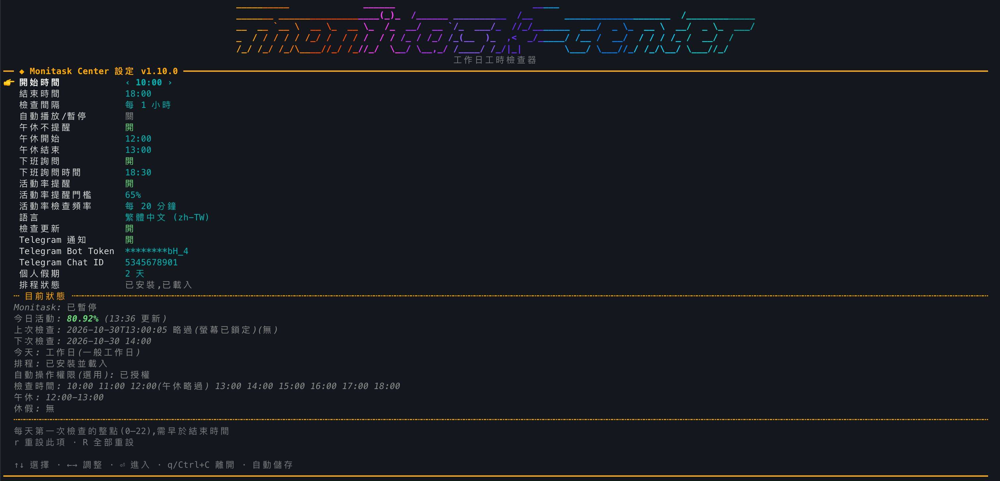
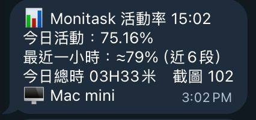

# monitask-center

跑在 **launchd 背景**的 Monitask 工時檢查器(會在固定時機自動播放/暫停)(不是 Claude skill,不需開 Claude)。由 `uv tool` 安裝的 `monitask-center` 指令管理，設定用互動選單 `monitask-center --config`。

**它做什麼：** 工作日的整點檢查 Monitask 有沒有在計時，忘了開就自動按播放(午休自動暫停、下班詢問後停止)，並用 Telegram 通知你結果；另有選用的活動率報表，定時推送今日活動率，並在今日活動率低於門檻時提醒。

**支援的作業系統：** 目前只支援 **macOS**(依賴 launchd、Accessibility 與 macOS 版 Monitask)；Windows / Linux 尚未支援。

**快速開始：** 見[首次設定](#首次設定)。

### 設定選單 `monitask-center --config`



### Telegram 活動率通知(選用)



## 核心原則

**平常只監看，只在兩個固定時機按播放/暫停。**

- 只會按 Monitask 的「播放」或「暫停」，且只有 `check.decide()` 判定需要時才按：沒有 Dock 點擊、不自動回應彈窗、不關閉 App。App 沒開或視窗被隱藏時，才會 `open -a Monitask` 並等待控制項出現(最長 30 秒)，按下後輪詢確認狀態真的改變。
- 離座不補點、不偽造工時，也沒有 F13 / 合成輸入 / 補活動。
- 狀態讀取集中在 `engine.py` 的 `read_state()`：先確認 App 是否執行，再讀 `~/Library/Application Support/Monitask/Periods/` 中最後修改的非空 JSON；`DateEnd` 距今小於 180 秒視為 `timing`，否則為 `paused`。`DateEnd` 隨計時持續推進；`DateLastActive` 只反映最後操作時間，閒置時仍可能正在計時，因此不作為暫停依據。Monitask 上傳後會刪除 Period 檔，所以目錄內沒有非空 JSON(只剩 0 位元組殘檔或為空)也視為 `paused`。不需 Accessibility(AX)權限；自動播放/暫停仍透過 `set_playing()` 使用 AX，並以按鈕狀態即時確認結果。
- 180 秒是暫定門檻(`PERIOD_MAX_AGE_S`)；檔案約每分鐘更新，暫停後最多約 3 分鐘才會辨識為 `paused`。尚待實際暫停觀察校準；此判定仍是檔案時間推估，不能保證等同計時器即時狀態。

## 每個工作日會發生什麼

launchd 在設定的整點喚醒 `check`（預設 10:00 ~ 18:00，每 1 小時，18:00 那一次也會檢查）。每次檢查依序判斷：

1. **今天是不是工作日**：台灣政府行事曆(含補班日) + 你自己設定的個人休假。個人休假優先於行事曆；放假/休假日不檢查、不提醒。行事曆讀不到時 **fail-open**：視為工作日，並每天最多通知一次。
2. **午休時段**：預設 12:00 ~ 13:00(`[12, 13)`)。午休內的檢查若 Monitask 還在計時(`timing` / `hidden`)就**自動按暫停**並通知(需開啟「自動播放/暫停」，關閉時只略過不動作)；已暫停或沒開則不通知、不動作。午休只在執行時判斷，不會改動 launchd 排程。
3. **讀取 Monitask 狀態並決定**：

| 狀態 | 行為 |
|------|------|
| `timing`(計時中；`running` 視同) | 安靜，只寫日誌 |
| `paused`(已暫停) / `not-running`(App 沒開) | **開始時間與午休結束那一次**(預設 10:00、13:00)：必要時開啟 Monitask 並**自動按播放**，成功或失敗都通知；其餘整點只發提醒通知(「自動播放/暫停」關閉時，全部只發提醒) |
| `unknown`(Period 目錄缺少或無法讀取、最新檔案格式錯誤或時間戳記不合法) | 發一則警告通知 |

自動播放失敗不會留下標記，下一個整點會退回提醒通知。每次結果會記錄到 `~/.monitask-center/last-check.json`。

## 下班詢問(overtime)

獨立的 launchd job `overtime`，每天在「下班詢問時間」(預設 18:30，可設 18:00–20:30、每 30 分鐘一格)執行：

- 只在**工作日**(同上，含個人休假)、螢幕未鎖定、且 Monitask 仍在計時(`timing` / `hidden`)時動作；已暫停、沒開或讀不到狀態一律安靜結束。
- 跳出視窗問「停止計時 / 繼續加班」，並同時發一則通知。**15 分鐘沒回應** 或選「停止計時」→ 自動按暫停；選「繼續加班」→ 30 分鐘後再問。等待期間若你已自己暫停就不再問。
- 每次選「停止計時」、「繼續加班」或逾時，都透過本專案既有通知功能回報原因及結果；等待期間已暫停、關閉或無法確認狀態時，也會回報未執行自動暫停。沿用 Telegram 開關，關閉或發送失敗時退回 macOS 通知。
- 視窗無法顯示時仍等滿 15 分鐘才暫停。暫停失敗會通知請手動處理。
- `--config` 的「下班詢問」可關閉；「下班詢問時間」改動會同步 launchd。這個 job 不受「自動播放/暫停」開關影響(它是你主動設定的詢問)，暫停仍需 Accessibility 授權。

## 首次設定

需要 macOS、Homebrew、[uv](https://docs.astral.sh/uv/)，並已安裝、登入 Monitask 桌面程式。不需要 clone 專案：

```bash
uv tool install --from git+https://github.com/weskao/monitask-center.git@vX.Y.Z monitask-center
monitask-center install          # 一次完成其餘設定
```

`X.Y.Z` 換成要安裝的[版本](https://github.com/weskao/monitask-center/releases)；省略 `@vX.Y.Z` 會裝 `main` 的最新程式。開發時在 checkout 用 `make install`(editable)。

`monitask-center install` 會依序：準備執行環境 → (選用)設定 Telegram → 載入 launchd job → 最終驗證 → 檢查輔助使用權限。每項檢查通過以 ✅ 標示；最終驗證(排程檔已安裝且 job 已載入)未通過以 ❌ 標示並以非零狀態結束，全部通過才顯示「✅ 安裝完成」。

輔助使用檢查(「自動播放/暫停」或「下班詢問」開啟時)讀取 TCC.db，確認授權已開啟且對應**目前**的 runner(重新簽章會改變 cdhash，舊授權即失效，下班「停止計時」會失敗)。未授權或已失效時，安裝程式會自動執行 `tccutil reset Accessibility com.dannylin.monitask-center` 清掉舊授權、以 app 身分啟動 runner 讓 macOS 列出目前版本並跳出詢問，再開啟「系統設定 → 隱私權與安全性 → 輔助使用」；你只需開啟 MonitaskCenter 的開關(macOS 不允許指令代為開啟)。終端機沒有「完整磁碟存取權」而無法讀取時，只跳出詢問(已授權則不顯示)，不會重設授權。此步驟不等待、也不會讓安裝失敗。

活動率通知使用獨立的 Node.js 排程，需在 checkout 內執行，並沿用 `monitask-center install` 建立的 python 執行環境讀取主設定。在 `activity/` 執行 `bash install.sh install` 時，缺少 Node.js 會由 Homebrew 安裝；安裝程式會輸出實際 Node 執行檔路徑，請將該路徑加入「系統設定 → 隱私權與安全性 → 完整磁碟存取權」。macOS 不允許安裝程式自行授予此權限。Node.js 更新後若背景工作再次出現 `EPERM`，請重新加入目前輸出的路徑。

活動率直接請求 Monitask 的 `/Report/TimeSpanPartial` HTML 資料，沿用專用登入 session，不等待網頁渲染。預設自動取得登入者自己的成員 ID，無需 OAuth client 或個人 ID 寫入程式。首次使用需先準備依賴與登入：

```bash
npm --prefix activity install
npm --prefix activity exec -- playwright install chromium
bash activity/run.sh login
bash activity/install.sh install
```

個別報表設定可在專案 `.env` 加入 `.env.example` 所列的 `MONITASK_ACTIVITY_TIMEZONE`（Windows 時區名稱，預設 `Taipei Standard Time`）及選填的 `MONITASK_ACTIVITY_MEMBER_ID`（空白表示本人）。指定其他成員需登入帳號具有其報表權限；若伺服器選出的成員不符設定，程式會拒絕傳送。報表時區不會改變主設定的工作日與通知排程。每次排程都會重新讀取 `.env`，更改這些值不需重新安裝；登入過期時重跑 `bash activity/run.sh login`。要立即以當下時間發送一次活動率（不受工作時窗限制），執行 `monitask-center activity`（或 `--activity`、`bash activity/run.sh now`）。此端點屬網站內部介面，格式仍可能改動。「最近紀錄」顯示報表中最新一段 10 分鐘的活動率及其起始時間（例如 14:25 傳送時顯示 14:20 那段）；該段尚未滿 10 分鐘時會標出實際分鐘數，計時已停止時則顯示最後一段的時間。

**低活動率提醒：** 活動率排程每 10 分鐘喚醒一次，依 `--config` 的「活動率檢查頻率」(預設每 10 分鐘，從開始時間起算，例如 10:00 開始、每 40 分鐘即 10:00、10:40、11:20…)比對**今日活動**與「活動率提醒門檻」(預設 60%)。低於門檻時發一則 Telegram 提醒，說明今日活動率、門檻與差距、最近紀錄，並提醒確認 Monitask 是否仍在記錄、離座請暫停計時。同一段 10 分鐘紀錄只提醒一次(記在 `~/.monitask-center/activity-alert.json`，送達後才記錄，失敗則下次重試)。只在工作日的開始～結束時間內(含結束整點，午休略過除外)且 Telegram 開啟時檢查；整點報表照舊。只在提醒時段內抓取失敗不會發 Telegram，只寫日誌，避免每 10 分鐘重複告警；`monitask-center activity` 只發報表，不觸發提醒。

- **執行環境全自動**：全部放在 `~/Library/Application Support/MonitaskCenter/`，不依賴任何 checkout。缺少 `python@3.13` 時用 Homebrew 安裝，把 PyObjC 裝到 `pylibs/`；產生 `MonitaskCenter.app`(內含 python runner)與 launchd 進入點 `run.sh`；runner 損壞或版本不符時自動重建並重新簽章。再次執行只修復壞掉的部分，所以已授予的 Accessibility 權限會保留。
- **安裝與狀態監看不需 Accessibility**。若要自動播放/暫停(`--config` 的「自動播放/暫停」，預設開啟)或下班停止計時，仍需到「系統設定 → 隱私權與安全性 → 輔助使用」授權 `MonitaskCenter.app`(`install` 會檢查並引導，見上)；未授權時動作會回報失敗並通知、結果寫入 `monitask.log`，且 runner 會請 macOS 重新跳出授權詢問，監看與一般提醒照常運作。關閉「自動播放/暫停」後只通知、不操作 Monitask，也就不需要此授權。`dump-windows` 診斷也需要 AX。
- **Telegram 是選用功能**：token 存於作業系統認證存放區(macOS Keychain / Secret Service / Windows Credential Manager)，以 `monitask-center --config` 的「Telegram Bot Token」列編輯，畫面上只顯示遮罩；chat id 是識別碼而非密鑰，直接存於 `config.json`。設定完成後會立即發送一則測試通知；安裝程式不檢驗是否送達，請自行到 Telegram 確認。本機沒有認證存放區時，`install` 才退回寫入 `~/.monitask-center/.env`(權限 600，範例見 `.env.example`)；既有的 `.env` token 會在下次 `install` 自動搬進認證存放區並從檔案移除。活動率排程(`activity/run.sh`)同樣優先使用 Keychain 的 token，專案 `.env` 的 `TG_BOT_TOKEN` 只在 Keychain 沒有時使用。Telegram 關閉或傳送失敗時退回 macOS 通知。

## 設定:`monitask-center --config`

互動選單(方向鍵 / 數字操作；管線或非 TTY 時自動退為編號式選單；遵守 `NO_COLOR`)。每次修改立即驗證並存檔。`r` 重設該列，`R` 重設全部(保留休假日)。

游標列標記：支援 emoji 的 UTF-8 終端機顯示 👉，其餘顯示 `> `；可用環境變數 `MONITASK_CENTER_POINTER=emoji|ascii` 強制指定。

| 列 | 說明 |
|----|------|
| 開始時間 | 第一次檢查的整點(預設 10) |
| 結束時間 | 最後一次檢查的整點(預設 18) |
| 間隔(小時) | 每幾小時檢查一次(預設 1，不可超過結束 - 開始) |
| 自動播放/暫停 | 開/關(預設開)；開啟時開工與午休結束自動按播放、午休自動按暫停；關閉時只通知，不操作 Monitask |
| 午休略過 | 開/關(預設開)；開啟時午休內不提醒(自動暫停/播放需開啟「自動播放/暫停」) |
| 午休開始 / 午休結束 | 午休時段 `[開始, 結束)`(預設 12 / 13) |
| 下班詢問 / 下班詢問時間 | 開/關(預設開)；時間 18:00–20:30、每 30 分鐘一格(預設 18:30) |
| 活動率提醒門檻 | 今日活動率低於此值就提醒(預設 60%)；10%–90%、每 5% 一格，←→ 切換，不需輸入 |
| 活動率檢查頻率 | 多久比對一次(預設 10 分鐘)；10–60 分鐘、每 10 分鐘一格，從開始時間起算，←→ 切換。兩者都在執行時讀取，不需重新載入排程 |
| 語言 | 在 `locales/` 內現有的語言間切換 |
| 檢查更新 | 開/關(預設開)；開啟時背景查詢 GitHub 最新版本，有更新就在指令結束後詢問(見下) |
| Telegram | 開：Telegram，失敗退回 macOS 通知；關：只用 macOS 通知 |
| 休假日 | 子選單：新增單日(`2026-10-05`)或區間(`2026-10-05~2026-10-09`)、移除、列出；顯示儲存檔案 `config.json` 的絕對路徑(遵守 `MONITASK_CENTER_HOME`) |
| 排程狀態 | 唯讀：launchd 是否安裝、載入、與設定一致 |
| 狀態區 | 唯讀：今天是否工作日、下次檢查、Monitask 狀態、上次檢查 |

### 設定工作日與休假

**工作日沒有開關**：週一至週五依台灣政府行事曆自動判定(國定假日不算、補班日算)，不用設定。要讓某天不檢查(請假、公司休息，或想略過的補班日)就把它加進**休假日**；休假優先於行事曆。

**方式一：用 `--config`**

1. 執行 `monitask-center --config`。
2. 用 ↑↓(或數字)移到「休假日」列，按 ⏎ 進入子選單。
3. 選「+ 新增日期或區間」按 ⏎，輸入 `2026-10-05`(單日)或 `2026-10-05~2026-10-09`(區間，最多 366 天)，再按 ⏎。
4. 要移除：在子選單移到該日期，按 ⏎ 或 `d`。非 TTY 的編號式選單改輸入 `a 日期` / `d 日期`。
5. Esc 返回。每次修改立即存檔，下一次檢查就生效，不需重新安裝。

**方式二：直接改檔案** `~/.monitask-center/config.json`(`MONITASK_CENTER_HOME` 設定時為 `$MONITASK_CENTER_HOME/config.json`)，編輯 `vacation` 陣列，每個日期一筆、格式 `YYYY-MM-DD`(檔案裡不支援區間)：

```json
"vacation": ["2026-10-05", "2026-10-06"]
```

無法解析的日期會被丟棄，下次存檔時自動排序去重。

**想把放假日當工作日**：沒有設定可用。進階做法是改行事曆快取 `~/.monitask-center/holidays/<年>.json` 中該日的 `"isHoliday"` 為 `false`(快取永久保留，不會重抓)。

選單頂端有 `monitask-center` 字樣 logo,與 tagline 一起水平置中(終端寬度 ≥ 70 欄且高度 ≥ 25 列顯示大字，≥ 46 欄顯示小字，更窄或高度不足時自動隱藏，只留單行標題)；調整視窗大小會自動重繪。

修改開始 / 結束 / 間隔後，選單會自動**重新產生 launchd plist 並只重新載入有差異的 job**(逐位元組比對已安裝檔)。若尚未安裝排程，只會提示訊息並保留設定，不會偷偷安裝。午休相關設定不影響排程。

## 其他指令

| 指令 | 說明 |
|------|------|
| `monitask-center install` | 首次安裝 / 修復(見上) |
| `monitask-center uninstall` | 移除排程與舊版殘留 job |
| `monitask-center status` | 唯讀狀態：工作日、檢查時段、下次檢查、午休、休假日、排程、選用的自動操作權限、Monitask、上次檢查 |
| `monitask-center plan` | 今天會不會檢查、哪些整點、下次時間(不接觸 Monitask) |
| `monitask-center check` | 立即執行一次檢查(仍遵守時段 / 午休 / 工作日規則，必要時會通知) |
| `monitask-center dump-windows` | 印出 Monitask 視窗與按鈕結構(診斷用) |
| `monitask-center logs` | 追蹤日誌；`logs --path` 只印出路徑 |
| `monitask-center config` | 等同 `monitask-center --config` |
| `monitask-center update` | 更新到最新的發行版本標籤(見「檢查更新」) |
| `monitask-center activity` | 立即以當下時間發送一次活動率到 Telegram(不受工作時段限制)。需先以 `bash activity/install.sh install` 安裝活動率排程，指令會執行該排程所指的 `activity/run.sh now` |

每個指令也可加上 `--` 前綴，結果相同(例如 `monitask-center --activity`、`--update`)；`config` 則也可不加 `--`。`monitask-center --help` 會列出全部。

Makefile 只是薄包裝：

```bash
make install     # 開發用，只安裝 CLI：uv tool install --editable . --force
make config      # monitask-center --config
make status      # monitask-center status
make plan        # monitask-center plan
make logs        # monitask-center logs
make activity    # monitask-center activity
make uninstall   # monitask-center uninstall
make test        # uv run --group dev pytest -q
make help        # 列出全部
```

## 檢查更新

預設開啟(`--config` 的「檢查更新」可關)。`monitask-center` 指令執行時會在背景查詢 GitHub releases API 的最新版本(公開 repo，不需登入；最多每 10 分鐘一次，結果存 `~/.monitask-center/update-check.json`)，指令結束後若有更新版本：

- 互動終端機：顯示選單 — 立即更新(`uv tool install --force --from git+https://github.com/weskao/monitask-center.git@<新版標籤> monitask-center`，裝的是該版本標籤而非 `main`，再用新版程式同步執行環境與 launchd)、略過(下次再問)、略過到下一版。
- 管線或非 TTY：只在 stderr 印一行提示，不阻塞。

`check`、`dump-windows`、`logs`、`activity`、`update` 與 launchd 排程不做檢查。離線或查詢失敗時靜默略過。

### 手動更新：`monitask-center update`

`monitask-center update`(或 `monitask-center --update`)一定會停在最新的發行版本標籤，不看 TTL 快取、也不受「檢查更新」開關與「略過到下一版」影響：

- 只有「執行中的版本等於最新標籤」**且**「安裝來源就是該標籤」(PEP 610 `direct_url.json` 的 `requested_revision`；沒有這份紀錄時以版本為準)才算最新，印出 `✅ … 已是最新版本` 後結束，不安裝任何東西。
- 其餘情況(舊版、比標籤新的版本、從 `main` 或某個 commit 安裝、從本機 checkout / editable 安裝)都會執行與「立即更新」完全相同的步驟：`uv tool install --force --from git+…@<標籤>`，再用新版程式同步執行環境與 launchd。從本機 checkout 安裝時會額外提示 checkout 本身沒有變動。
- 結束時不會再跳出指令後的更新詢問。
- 不接受其他參數：`update --help`、`update foo` 一律拒絕，不會安裝。

| 結束碼 | 意義 |
|------|------|
| `0` | 已是最新，或已更新到最新標籤 |
| `1` | 查不到最新版本(離線 / GitHub API 限流)，或安裝 / 同步步驟失敗(會印出手動指令) |
| `2` | 帶了多餘的參數 |

## launchd 排程

兩個 job：`com.monitask-center.check` 用 `StartCalendarInterval` 在每個設定的整點(分鐘 0)各一筆；`com.monitask-center.overtime` 見「下班詢問」。兩者都經由 `~/Library/Application Support/MonitaskCenter/run.sh` 執行。

安裝與移除時會一併清掉舊版 job：`morning`、`lunch`、`afternoon`、`evening`、`night-start`、`night-stop`、`watch`(標籤 `com.monitask-center.<名稱>`)，以及舊 bundle id 前綴 `com.dannylin.monitask-center.*` 與 `com.dannylin.monitask.*` 的對應 job。

手動觸發一次(繞過時間，但仍遵守時段 / 午休 / 工作日規則)：

```bash
launchctl kickstart -k gui/$(id -u)/com.monitask-center.check
```

## 檔案結構

| 路徑 | 角色 |
|------|------|
| `TODO.md` | 待辦與建議事項 |
| `src/monitask_center/engine.py` | 狀態引擎(本機 Period 檔案；按鈕操作使用 AX)，含 `set_playing()` 按播放/暫停。子命令：`check` / `overtime` / `status` / `dump-windows`；`read_state()` 回傳 `timing` / `paused` / `unknown` / `not-running` |
| `src/monitask_center/_pyfix/sitecustomize.py` | 補 `platform.mac_ver()`(僅 pip 下載 wheel 時用到) |
| `src/monitask_center/` | `uv tool` 指令套件(僅標準函式庫)：`cli.py` 指令入口、`config.py` 設定、`update_check.py` 更新檢查(與 aicp 共用同一份)、`check.py` 判斷與上次檢查紀錄、`workday.py` 工作日、`launchd.py` 排程、`install.py` 安裝、`status.py` 狀態、`notify.py` 通知與日誌、`i18n.py` 多語系 |
| `src/monitask_center/tui/` | `--config` 選單：`menu.py`、`present.py`、`keyreader.py`、`logo.py`(兩種尺寸的標題 logo) |
| `src/monitask_center/locales/<lang>/*.json` | 各語言文字(目前 `zh-TW`) |
| `tests/` | pytest 測試(含 i18n 守門) |
| `docs/images/` | README 用的截圖：`config-menu.jpeg`(設定選單)、`telegram-notification.jpeg`(活動率通知) |
| `activity/` | 活動率監控，**獨立的選用功能**，有自己的 launchd job；讀主設定時使用 `~/Library/Application Support/MonitaskCenter/` 的 python 與 `pylibs` |
| `.env` | 活動率監控的設定(`activity/run.sh` 讀取，不入版控) |
| `~/.monitask-center/.env` | 僅在無認證存放區時的後備：`TG_BOT_TOKEN` + `TG_CHAT_ID` |
| `~/.monitask-center/config.json` | 使用者設定(單一檔案，不放在專案目錄) |
| `~/.monitask-center/last-check.json` | 上次檢查結果 |
| `~/.monitask-center/holidays/` | 政府行事曆快取(每年一檔) |
| `~/Library/Application Support/MonitaskCenter/run.sh` | launchd 進入點(由 `install` 產生)：`PYTHONPATH` 設為 `pylibs` 與已安裝的套件，載入 `~/.monitask-center/.env`，再用 bundle 內 python 執行 `python -m monitask_center.engine` |
| `~/Library/Application Support/MonitaskCenter/MonitaskCenter.app` | 內含 python 副本；**AX 授權對象**(TCC 身分 `com.dannylin.monitask-center`)，勿刪 |
| `~/Library/Application Support/MonitaskCenter/pylibs/` | 安裝程式透過 pip 裝入的 PyObjC wheel 與 telegram-kit |
| `~/Library/Application Support/MonitaskCenter/monitask.log` | 日誌 |

## 多語系(i18n)

程式碼中不放任何中文；所有使用者可見文字都走 `monitask_center.i18n.t("key", ...)`，文字在 `src/monitask_center/locales/<lang>/*.json`(扁平的 key → 文字；同一語言目錄下所有 `*.json` 會合併，跨檔重複 key 視為錯誤)。

新增語言：

1. 複製 `src/monitask_center/locales/zh-TW/` 為 `src/monitask_center/locales/<lang>/`。
2. 只翻譯值，key 與 `{placeholder}` 名稱必須完全相同；`tui.language.self` 填該語言自己的名稱。
3. 設定選單的「語言」列會自動出現新語言，用左右鍵切換。

查找順序：**目前語言 → `zh-TW` → key 本身**，所以漏翻的字會退回 `zh-TW`，不會空白或當掉。`tests/test_i18n_catalog.py` 會檢查程式碼沒有中文、每個 `t("key")` 都存在且佔位符一致、沒有孤兒 key、各語言目錄可乾淨合併。

## 通知一覽

| 事件 | 通知 |
|------|------|
| Monitask 已暫停 / 沒有執行(工作日、非午休) | 提醒 |
| 無法讀取 Monitask 狀態(Period 檔案或時間戳記異常) | 警告 |
| 政府行事曆無法取得(fail-open) | 警告，每天最多一次 |
| 計時中 / 視窗隱藏 / 午休 / 放假 / 休假 / 時段外 | 不通知，只寫日誌 |
| 今日活動率低於「活動率提醒門檻」(需安裝活動率排程) | Telegram 提醒並說明，同一段紀錄一次 |

通知先走 Telegram(`telegram-kit` 直連 Bot API；token 取自認證存放區，其次為 `.env` 的 `TG_BOT_TOKEN`；chat id 取自 `config.json`，其次為 `TG_CHAT_ID`；訊息附主機名)，Telegram 關閉或傳送失敗時退回 macOS 通知中心。只發文字，不截圖、不外傳畫面內容。

## 維護注意

- **需要自動播放/暫停時保留 AX 授權** `MonitaskCenter.app`；移除授權不影響狀態讀取與提醒。launchd 一律經 `run.sh` 以 `/bin/bash` 呼叫 bundle 內 python(直接 exec bundle 執行檔會被當 app 啟動而失效)。
- **brew 升級 `python@3.13`** 可能讓 bundle 內 python 副本連結的 framework 路徑失效：重跑 `monitask-center install` 會重建 runner 並重新簽章；重簽後舊的 Accessibility 授權失效，同一次 `install` 的輔助使用檢查會重設並開啟設定面板，開啟 MonitaskCenter 即可。
- **執行環境不在 checkout 裡**：launchd 執行 `~/Library/Application Support/MonitaskCenter/run.sh`，它指向目前安裝的 `monitask_center` 套件(git 標籤安裝時在 uv tool venv，editable 安裝時在 checkout 的 `src/`)。換了安裝方式或 venv 的 Python 版本，任何 CLI 指令(`install`/`uninstall` 除外)都會重寫 `run.sh`。
- **從 1.5.0 以前升級**：舊版的 job 從 checkout 執行。新版在「立即更新」的同步步驟，或任何 CLI 指令(`install`/`uninstall` 除外)時，會把 `MonitaskCenter.app`(保留 Accessibility 授權)、`pylibs`、`.env` 從 checkout 複製到上述目錄，產生 `run.sh`，再把 job 改指向它。若 `git pull` 已刪掉 checkout 內的 bundle，會用 Homebrew 的 python 重建並重新簽章，這時可能需要重新授予 Accessibility。整點 `check` 無法自行搬移(它本身就從舊位置執行)，所以 `git pull` 之後請執行任一 `monitask-center` 指令。
- **低活動率提醒的排程升級**：舊版 `activity/install.sh` 裝的活動率 job 每小時喚醒一次。新版的整點 `check` 或任何 CLI 指令(`install`/`uninstall` 除外)會自動把它改成每 10 分鐘(只改排程，保留 Node 路徑與 checkout 位置)；沒裝活動率排程時不做任何事。失敗時會提示在 checkout 重跑 `bash activity/install.sh install`。
- 開發時用 `make install`(editable)：修改程式碼不需重新安裝；若改了 launchd 內容(`launchd.py`)，到 `--config` 改任一排程設定或重跑 `monitask-center install` 即可套用。
